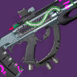

# gridskipper
A library and utility for computing image differences and determining whether pixels in an image
were shaded due to antialiasing.

## Motivation
[Vyšniauskas' 2009 paper](https://www.researchgate.net/publication/234126755_Anti-aliased_Pixel_and_Intensity_Slope_Detector) on detecting antialiasing using image intensity values is the current best-practice for detecting whether a pixel was shaded because of  anti-aliasing. It works by detecting a gradient shift between a local pixel area, in 9 possible directions. For synthetic images, such as can be seen with fonts, this works quite well. 

This project is an attempt to improve the statistical inference of whether a pixel is a result of
antialiasing in order to find a method that more generally covers slight shifts in sub-pixel
positioning (such as if a glyph in a web browser is placed slightly to the left or right, but still
within a particular pixel). This sub-pixel positioning shift causes the antialiasing to differ, sometimes resulting in a change that is not caught by the original algorithm. Work is ongoing to create a more robust algorithm for this purpose.

During the development, however, a differencing system was ported from [Pixelmatch](https://github.com/mapbox/pixelmatch) to aid in the detection algorithm. Since the performance of this library is slightly better than Pixelmatch's javascript implementation, this was left for use by others. Note that it will likely diverge over time and become different from the Pixelmatch implementation.

## Name

[gridskipper](https://www.light.gg/db/items/1621558458/gridskipper/) is a gun from Destiny 2, introduced during Season of the Splicer. Since I play a lot of Destiny 2, this was in my mind at the time I created the library, and I used it as a placeholder name, as "skipping sections of the grid" sounded like what I wanted to achieve. I'm lazy so never changed it away from the "code name" that I started with.